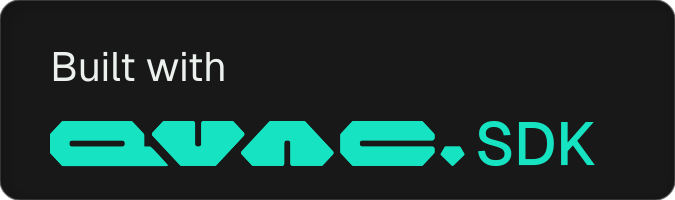

# QVAC OpenMOSS Audio Demo

<picture>
  <source media="(prefers-color-scheme: dark)"  srcset="docs/badges/built-with-qvac-dark-mode-landscape.svg">
  <source media="(prefers-color-scheme: light)" srcset="docs/badges/built-with-qvac-light-mode-landscape.svg">
  
</picture>

Three open audio models from OpenMOSS, running on your own computer with the QVAC SDK: a voice that
reads any line in 31 languages, a dialogue between up to five voices, sound effects from a
sentence, and a sound scene that puts a generated ambience under a dialogue. Nothing is sent
anywhere: the models download once, then everything runs locally.

> **This is an example, not a product.** A self-contained prototype showing what the QVAC SDK can
> do with OpenMOSS, provided as is, with no support and no warranty.

## What it does

| Tab | Model | What you can do |
|---|---|---|
| Expressive speech | MOSS-TTS v1.5 | Read a line in 31 languages; clone a voice from one recording, no transcript needed; `[pause 2.0s]` markers; IPA (`/təˈmɑːtoʊ/`) or Pinyin (`ni3 hao3`) for pronunciation; a target length; the audio plays while the rest is still being generated |
| Dialogue | MOSS-TTSD | A script tagged `[S1]` to `[S5]`, voiced in one pass, with the model's voices or with voices you record (each speaker reads one sentence aloud) |
| Sound effects | MOSS-SoundEffect v2 | Describe a sound, pick 4 to 30 s and a quality, list what to avoid; 48 kHz |
| Sound scene | MOSS-TTSD + MOSS-SoundEffect | A dialogue over a 30 s ambience (a dog barking, rain, an office), looped if needed and mixed 10 dB under the voices; the same ambience is reused by the next take |

Every take is saved in `out/` with its settings, and "Another take" runs the same settings with a
new random seed. The examples on each tab keep the seed they were picked with, so they play back
the same way.

## Quickstart

```bash
npm install
npm start
```

Open http://localhost:3102. Each tab says what it still needs to download; the button downloads
it from the QVAC Registry with progress. After that, the demo works offline.

The server only answers this computer. To open it from a phone on the same network, start it with
`HOST=0.0.0.0 ALLOWED_HOSTS=<this computer's address>:3102 npm start`; anyone on that network can
then use it. Remove deletes a take's audio and a recorded voice from the disk, not only from the list.

## The models

All five files come from the QVAC Registry and land in the SDK's model cache, `~/.qvac/models`.

| File | Used by | Size |
|---|---|---|
| MOSS-TTS v1.5 backbone (`moss-tts-delay-f16.gguf`) | Expressive speech | 17.0 GB |
| MOSS-TTSD backbone (`moss-ttsd-f16.gguf`) | Dialogue, sound scene | 16.7 GB |
| MOSS codec decoder (`moss-codec-decoder-f16.gguf`) | Speech, dialogue, scene | 1.8 GB |
| MOSS codec encoder (`moss-codec-encoder-f16.gguf`) | Cloning a voice | 1.8 GB |
| MOSS-SoundEffect v2 (`moss-sfx-v2-q8_0.gguf`) | Sound effects, sound scene | 3.5 GB |

40.8 GB for everything. Each tab downloads only what it uses: 20.5 GB for speech, 20.3 GB for the
dialogue, 3.5 GB for sound effects.

## Measured

On a 36 GB MacBook Pro (Apple M5 Max, Metal), QVAC SDK 0.21.0:

| Job | Audio | Time to make |
|---|---|---|
| Expressive speech, one line | 9.4 s | 6.6 s, first sound after 2.6 s |
| Cloned voice, one line | 5.8 s | 4.7 s |
| Dialogue, three model voices | 10.6 s | 6.4 s |
| Dialogue, two recorded voices | 9.0 s | 6.3 s |
| Sound effect, Draft (25 steps) | 4.0 s | 24 s |
| Sound effect, Standard (50 steps) | 8.0 s | 48.5 s |
| Sound effect, Full (100 steps) | 8.0 s | 97.6 s |
| Sound scene, new Standard ambience | 12.8 s | 55.7 s |

Loading a speech backbone takes about 5 s. A sound effect costs the same at any length: the model
always works on a 30 s clip and crops it, so the quality setting (the number of steps) is what
sets the time.

## How it is built

- `server.js`: a `node:http` server bound to 127.0.0.1. Speech and dialogue go through the QVAC SDK
  (`loadModel` with `ttsEngine: 'moss'`, then `textToSpeech` with `stream: true`). One speech model
  is loaded at a time: the two backbones are 17 GB each.
- `engine/sfx.cjs`: one sound effect in the Bare runtime, then exit. The sound-effect engine is in
  `@qvac/tts-ggml` from 0.11.0, a Bare addon, and the SDK 0.21 does not expose it yet.
- `lib/models.mjs`: the five registry files, where the SDK caches them, and the downloads.
- `lib/wav.mjs`: WAV reading and writing, and the scene mix.
- `public/`: the page. It plays speech while it is generated, records the voices to clone and
  converts any audio file to the 24 kHz mono WAV that MOSS clones from.

## Known limits

- **A dialogue sometimes does not end.** With the SDK 0.21 defaults, MOSS-TTSD sometimes speaks
  the lines and then keeps generating silence up to its 162.6 s budget, and with some seeds a take
  with recorded voices is silent from the start. The demo watches the audio as it arrives: 5 s of
  silence after the last word ends the take there, and no speech in the first 8 s stops it with a
  message. "Another take" then tries another seed. In our runs with recorded voices, three seeds out
  of four gave a take, and one of the three dropped the end of its last line.
- **Sound effects come from `@qvac/tts-ggml` 0.11, not from the SDK yet.** The SDK 0.21 bundles
  0.10, which has no sound-effect engine, so the demo depends on 0.11 directly and runs it in Bare.
  When an SDK release exposes MOSS-SoundEffect, that tab can move to the SDK like the others.
- **Dialogue languages.** The script tags and the examples are English; MOSS-TTSD is multilingual,
  and the language picker sets its hint.

## Recommended hardware

| | Requirement |
|---|---|
| **Computer** | Tested on macOS with Apple Silicon. MOSS runs its 8B backbones on a desktop GPU |
| **RAM** | 32 GB or more (tested on 36 GB). A speech backbone with its codec is about 21 GB in memory |
| **Disk** | 41 GB for the five models, plus the SDK |
| **Microphone** | Only to record a voice to clone; a file works too |

## Requirements

- Node.js 22.17 or newer
- About 45 GB of free disk

## Licences

The demo is Apache 2.0. MOSS-TTS v1.5, MOSS-TTSD and MOSS-SoundEffect are Apache 2.0 models by
OpenMOSS ([Hugging Face](https://huggingface.co/OpenMOSS-Team)); the weights download from the
QVAC Registry and are not in this repository.
